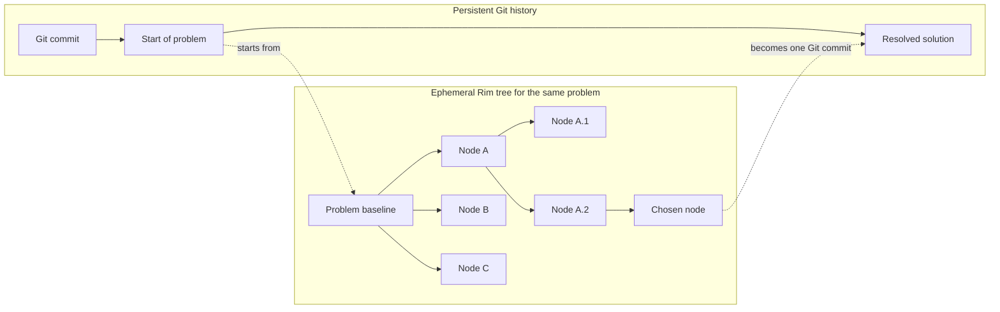
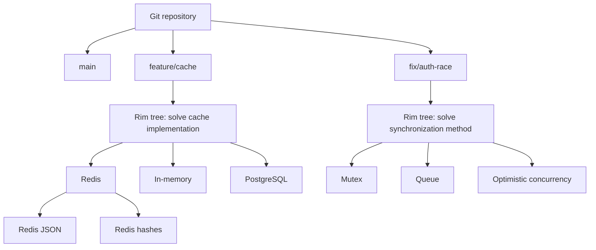
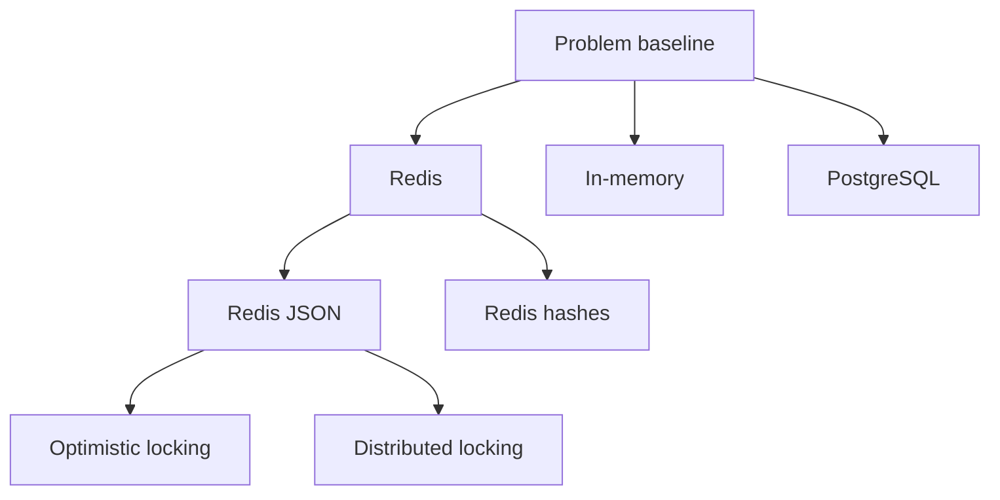
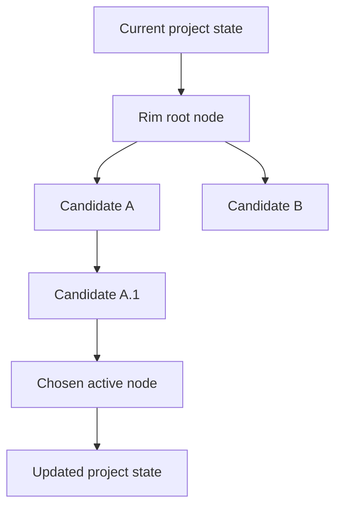

# PRODUCT.md — `rim` (Direction Manager)

> A CLI for temporary solution trees in AI-assisted development. `rim` lets
> users and agents test many ways to solve the same problem before the result
> becomes durable project history.

---

## 1. Core Value Proposition

### The Core Problem

Agentic development makes code generation cheap. It does not make code review
or evaluation cheap. An agent can create many substantial attempts before a
user knows which parts are useful.

Git can store these attempts, but its normal interface treats branches and
commits as durable development history. Temporary agent work then creates
speculative debt:

- throwaway branches fill the branch list.
- temporary commits look like intentional project history.
- worktrees, names, and ancestry require manual management.
- useful fragments remain trapped in otherwise unsuccessful attempts.
- users must repeatedly choose whether to keep or delete uncertain work.

Without `rim`, the user gets a binary choice:

```text
Delete the branch
    -> keep the repository clean
    -> risk losing useful work

Keep the branch
    -> preserve the work
    -> accumulate branch and cognitive clutter
```

`rim` adds an ephemeral layer between active edits and durable history:

```text
Git branch:
    assumed valuable until deliberately deleted

Rim node:
    assumed temporary until deliberately kept or purged
```

Rim nodes remain available without becoming normal Git branches. The user can
inspect a node, switch to it, extend it, or delete its complete subtree.
The user can keep the active node and its ancestry while purging all other
attempts.

### What `rim` Is

`rim` manages a temporary tree of solutions to one problem. Each node is an
editable candidate state. Two or more child nodes form alternative branches
from their parent.

A Rim node and a Rim branch are not separate object types. A node is a state in
the tree. A branch is a node and the path that develops from it. The terms
provide two views of the same temporary structure.

`rim` is not:

- a replacement for Git history.
- a system for long-lived feature branches.
- an agent loop or prompt manager.
- an evaluation dashboard.
- a decision engine that chooses the best solution.

---

## 2. Git and Rim Work at Different Levels

A Git branch can represent a durable problem or line of development. A Rim
tree represents temporary attempts to solve that one problem.



All nodes in one Rim tree address the same problem. Child nodes test variations
of a parent solution. They do not represent unrelated project work.

The chosen Rim node becomes the project working state. In Git mode, the user
records that state with a normal Git commit. The user can then purge the
remaining Rim tree.

### Stacking Git Branches and Rim Trees

Git branches and Rim trees can stack without sharing the same role:



Git preserves the project history between problems. Rim manages the temporary
search within one problem. Only the chosen result needs to enter Git history.

---

## 3. The Rim Tree Model

### Nodes Are Editable

Git and Rim use opposite defaults. A Git commit is a fixed historical state.
New work creates a successor commit. Revising the previous commit requires an
explicit amend or history rewrite.

A Git commit object never changes. An amend creates a replacement commit and
moves the branch reference. This behavior makes each saved state part of a
durable sequence by default.

A Rim node is an editable candidate state. A punch keeps the node identity and
updates its consolidated state. The user spawns a child only when the work
should become a separate candidate.

Each active node has two layers:

```text
consolidated node state
    + hot workspace changes
    = current visible state
```

Hot changes are differences between the active node's consolidated state and
the current project files. They belong to the active line of work, but Rim has
not yet stored them in a node. Rim has no staging layer of its own. The user can
either punch the changes into the active node or spawn a child that captures
them while leaving the parent unchanged.

`rim punch` consolidates the hot changes into the active node:

```text
Before rim punch:
    Node A snapshot + hot changes

After rim punch:
    Node A updated snapshot + no hot changes
```

A punch updates the same Rim node. It does not create a child node or a normal
Git commit. A spawn makes the separate candidate explicit.

### Nodes Can Form Sub-Branches

`rim spawn` creates child nodes from the active node. A child records the
active node's consolidated state as its parent state. Its own state also
includes any current hot changes captured when it is spawned.



A child keeps the parent snapshot that existed when the child was spawned. A
later punch to the parent does not silently modify existing children.

The tree relation still remains. Rim records the exact parent snapshot used at
spawn time so it can compare the child correctly.

### Roots and Node Identity

Rim trees are rooted in project states, not in required session objects or Git
branches. A session name can be a user convenience, but it does not define node
identity or ownership. Every Rim node has an identifier that is unique within
the repository scope.

In Git mode, every Git commit can become the root of a Rim tree. The current
Git commit determines the applicable Rim root. Each root remembers its own active
node. If the user returns to a prior commit, Rim resumes the active node for
that root.

`rim init` explicitly creates a base node for the current Git commit. If no root
exists, the first `rim spawn` creates the base node and then creates a child.
When the Git commit changes, Rim uses a root anchored to the new commit. If that
root does not exist, the next spawn creates it. Rim does not continue the prior
commit's tree under the new commit.

At root creation, Rim copies the base project state into Rim-owned storage. The
origin commit ID records provenance, but the Rim root does not depend on that
Git object. An amend, branch deletion, or Git garbage collection cannot remove
the stored Rim base or its descendants.

Outside Git, `rim init` or the first `rim spawn` uses the current project state
as the base node.

### One Node Is Active

One node is active in the current root. Its files appear in the current project
directory. `rim switch` replaces those files with the target node state.

Rim must not silently discard hot changes. Before switching to another node,
the user must save the changes by punching them into the active node or
spawning a child node from them.

If the target node belongs to a different Git root, Rim reports that its base
commit differs from the current `HEAD`. Rim asks whether it can change `HEAD`
to the target base commit. If the user declines, Rim stops and tells the user
to change `HEAD` before trying the command again.

Rim change tracking is independent of Git's index and commits. Staging or
committing files with Git does not punch a Rim node, and punching a Rim node
does not stage or commit those files with Git. The same project changes may be
stored in Rim, Git, both, or neither. Rim therefore determines hot changes by
comparing the project files with the active Rim node, not by consulting Git's
staging area.

### Nodes Stay Until Purged

Rim does not require archive, park, freeze, or lifecycle states. Nodes remain in
the tree until the user purges them.

Rim can report structural status without adding a lifecycle:

- which node is active.
- whether the active node has hot changes.
- which parent and children a node has.
- when a node was last punched.

---

## 4. Core Operations

The core mutation commands are small and tree-oriented.

### `rim init`

Create a base node without creating a child.

```bash
rim init
```

In Git mode, the base is anchored to the currently checked-out Git commit. In
standalone mode, the base captures the current project state. Explicit
initialization is optional because `rim spawn` performs it when necessary.

### `rim spawn`

Create one or more child nodes from the active node.

```bash
rim spawn [--tag <name>] [--fan-out <n>]
```

A single new child becomes active. With `--fan-out`, Rim creates sibling nodes
and keeps the parent active until the user switches to a child.

If no base node exists for the current Git commit, or for the current project
state in standalone mode, Rim initializes one before spawning. If hot changes
exist, the new child captures the resulting project state and the parent keeps
its previously consolidated state. Spawning is therefore one of the two ways
to save hot changes; punching saves them into the current node instead.

### `rim punch`

Consolidate hot changes into the active node.

```bash
rim punch [-m <message>]
```

A punch updates the active node's stored state. It does not add a node to the
tree and does not write a normal Git commit.

### `rim switch`

Make another node active.

```bash
rim switch <node-id>
```

Rim materializes the target node in the current project directory. If hot
changes exist, Rim requires the user to save them first with `rim punch` or
`rim spawn`.

If the target node has a different Git base from the current `HEAD`, Rim warns
the user and asks for permission to change `HEAD`. If the user declines, Rim
stops. The user can then change `HEAD` with Git and try again. If Git no longer
has the target base commit, the MVP refuses the switch. Recovery of a missing
base commit is a deferred design problem.

### `rim purge`

Delete one node and all of its descendants.

```bash
rim purge <node-id>
```

If the subtree contains the active node, Rim refuses the operation. Purging a
node removes all child nodes and sub-branches below it.

### `rim purge --all`

Keep the active node and its parent lineage, and delete all other nodes.

```bash
rim purge --all
```

Rim retains the path from the base node through the active node. It removes
siblings, their descendants, and any descendants of the active node. This
operation requires user confirmation.

### Read-Only Inspection

Read commands do not change the tree:

```bash
# Show the node tree and active node
rim tree [--json]

# Show node and project status
rim status [<node-id>] [--json]

# Compare a node with its parent, or compare two nodes
rim diff <node-id> [<other-node-id>] [path...] [--json]
```

---

## 5. Git Mode

Rim detects a Git repository and associates each tree root with the current
Git commit. Rim does not create normal Git branches for its nodes, and its
active node and change tracking remain independent of Git's index.

### Ownership and Storage

Git owns:

- `HEAD`, branches, and commits.
- the Git index.
- Git status.

Rim owns:

- root and node identities.
- node relationships.
- base and node snapshots.
- the active node for each root.
- Rim status.

Git does not store Rim state. Rim records an origin commit ID for a Git-based
root, but it also stores an independent copy of the base project state. The
commit ID is provenance rather than required storage.

Neither tool stores the other tool's status. Git calculates status by comparing
`HEAD`, the index, and the project files. Rim calculates status by comparing
the active node snapshot with the project files.

Rim keeps its object store in `.rim/`, separate from the enclosing Git object
database. Rim implements this storage directly and does not call an external
Git executable to manage it. The format uses Git-style content addressing,
immutable objects, complete logical trees, and structural sharing. Rim owns the
format, metadata, integrity checks, and garbage collection.

### Final Result

The active node is the chosen solution. Its state appears in the enclosing
Git working tree. The user reviews and commits it with normal Git commands:

```bash
rim switch redis-json
rim purge --all
git diff
git add .
git commit -m "Implement application caching"
```

The durable Git history stays simple:

```text
A──B──C    feature/cache
```

The temporary Rim tree does not become part of the public ancestry of commit
`C`.

### Git Safety Rules

The user owns normal Git branches and commits. Rim owns its private snapshots
and metadata.

Rim must not:

- create or move `refs/heads/*` without an explicit Git operation.
- rewrite durable Git history.
- treat Git's index as Rim's staging system.
- apply a Rim tree to a different Git context without confirmation.
- silently include ignored secrets in a node snapshot.

---

## 6. Standalone Mode

Rim uses the same tree model when Git is absent.



Rim stores node snapshots in its own content-addressed store or snapshot
backend. `init`, `spawn`, `punch`, `switch`, and `purge` keep the same
user-facing behavior as Git mode.

Standalone Rim history is local to the repository scope. It gives the user
temporary version management while solving a problem. It does not replace
durable source-control history, remotes, or collaboration.

After `rim purge --all`, the active node and its parent lineage remain. Rejected
alternatives are removed after confirmation.

---

## 7. Scope Boundaries

```text
┌──────────────────────────────────────────────────────────────┐
│ High-Level Layers (OUT OF SCOPE)                            │
│                                                              │
│ - Agent prompting, loops, and LLM chains                     │
│ - Evaluation dashboards                                     │
│ - Choosing the best node                                    │
│ - Long-term lifecycle states                                │
│ - Durable feature and release history                       │
└──────────────────────────────┬───────────────────────────────┘
                               │
                               ▼
┌──────────────────────────────────────────────────────────────┐
│ Rim Core Scope                                               │
│                                                              │
│ 1. Spawn an ephemeral tree for one problem                  │
│ 2. Edit and punch the current node                           │
│ 3. Switch between candidate nodes                            │
│ 4. Expose node structure, state, and diffs                   │
│ 5. Keep temporary states outside durable project history     │
│ 6. Purge one subtree or all nodes outside the active lineage│
└──────────────────────────────┬───────────────────────────────┘
                               │
                ┌──────────────┴──────────────┐
                ▼                             ▼
          Git project                    Standalone project
        Rim-owned object store         Rim-owned object store
```

Multi-candidate evaluation can call Rim through CLI and JSON output. Rim exposes
the candidate states but does not decide which one is correct.

---

## 8. Deferred Design Problems

These problems are part of the product direction, but they do not belong to
the first tree-management design.

### Concurrent Node Validation

An agent can need to build or test several nodes of the same project at the
same time. One active project workspace does not support this use case.

A later design must determine how Rim:

- materializes several node workspaces at the same time.
- shares dependencies without copying unnecessary data.
- gives each workspace separate ports and runtime variables.
- prevents test processes and development servers from colliding.
- releases workspace and process resources after validation.

Git worktrees can provide part of this mechanism in Git mode. They still leave
Rim responsible for dependency storage, secrets, ports, processes, and cleanup.
Standalone mode needs equivalent behavior without Git worktrees.

The workspace design must preserve the existing Rim tree semantics. Concurrent
validation must not turn Rim nodes into normal Git branches.

### Rim Storage Backend

Rim keeps snapshots in a Rim-owned content-addressed store under `.rim/`. It
does not use the enclosing Git object database and does not invoke Git to
manage Rim objects. The implementation uses Git's storage principles rather
than Git's repository ownership or commit model.

The backend must provide:

- complete logical snapshots that do not depend on parent nodes.
- immutable blobs and directory trees addressed by content hashes.
- content sharing for unchanged files and directories.
- efficient replacement of a node with a substantially different snapshot.
- independent garbage collection.
- integrity checks and atomic writes.
- the same node semantics in Git and standalone projects.

Rim node metadata remains separate from immutable snapshot objects. A punch
moves a stable node identity to a new snapshot. Existing children retain the
exact parent snapshot from which they spawned.

### Missing Git Origin Recovery

A Rim root remains valid when Git no longer has its origin commit because Rim
stores an independent base snapshot. The MVP does not recreate a missing Git
commit or attach the root to another commit.

If `rim switch` needs a base commit that Git no longer has, the command reports
the missing origin and stops. A later design can define an explicit recovery
operation that creates or chooses a replacement Git context without losing the
original provenance.

---

## 9. Internal Directory Structure

A possible Rim-owned layout is:

```text
.rim/
├── config.json                 # Storage format and runtime settings
├── state.json                  # Roots, nodes, and active-node metadata
├── objects/                    # Content-addressed blobs and trees
├── indexes/                    # Private snapshot indexes
└── workspaces/                 # Deferred concurrent node workspaces
```

Rim uses `.rim/` in both Git and standalone projects. Rim must exclude this
directory from its own snapshots. In a Git project, the user must not commit
`.rim/` as durable project content.

---

## 10. Design Principles

1. One Rim tree addresses one problem.
2. Rim nodes are temporary and editable.
3. A punch updates a node instead of adding durable history.
4. A child records the exact parent state from which it spawned.
5. One node is active and appears in the current project directory.
6. Nodes remain available until the user purges them.
7. Purging a node also purges all descendants.
8. `rim purge --all` keeps the active node and its parent lineage.
   The command requires confirmation.
9. Git stores durable project history. Rim stores ephemeral solution search.
10. A Git origin identifies provenance but does not store the Rim base.
11. Git does not store Rim state, and Rim does not store Git status.
12. Git and standalone modes expose the same Rim tree operations.
