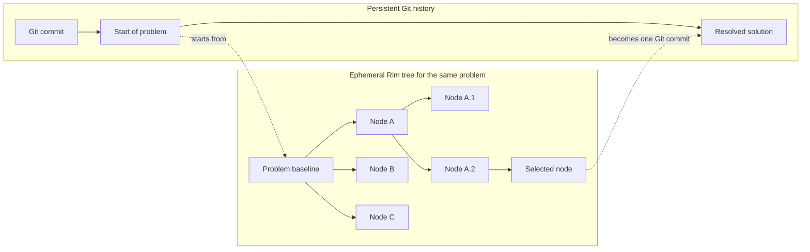
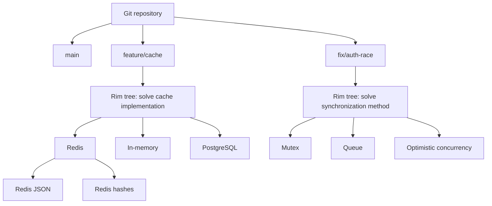
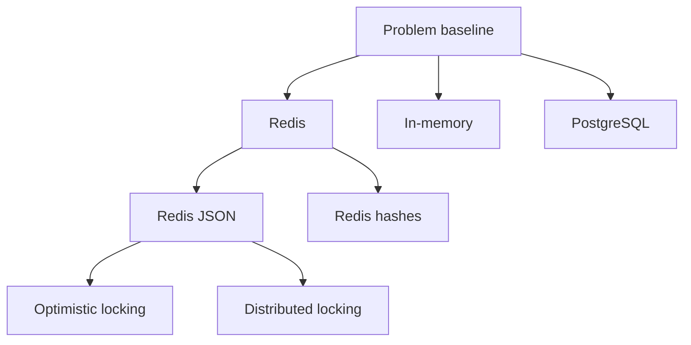
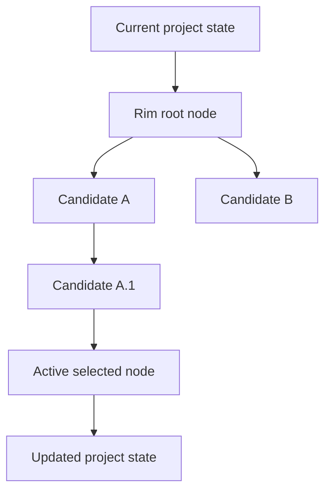

# PRODUCT.md — `rim` (Direction Manager)

> A CLI for temporary solution trees in AI-assisted development. `rim` lets
> users and agents test many ways to solve the same problem before the result
> becomes durable project history.

---

## 1. Core Value Proposition

### The Core Problem

Agentic development makes code generation cheap. It does not make code review
or evaluation cheap. An agent can create many substantial attempts before a
user knows which parts are useful.

Git can store these attempts, but its normal interface treats branches and
commits as durable development history. Temporary agent work then creates
speculative debt:

- throwaway branches fill the branch list.
- temporary commits look like intentional project history.
- worktrees, names, and ancestry require manual management.
- useful fragments remain trapped in otherwise unsuccessful attempts.
- users must repeatedly choose whether to keep or delete uncertain work.

Without `rim`, the user gets a binary choice:

```text
Delete the branch
    -> keep the repository clean
    -> risk losing useful work

Keep the branch
    -> preserve the work
    -> accumulate branch and cognitive clutter
```

`rim` adds an ephemeral layer between active edits and durable history:

```text
Git branch:
    assumed valuable until deliberately deleted

Rim node:
    assumed temporary until selected or purged
```

Rim nodes remain available without becoming normal Git branches. The user can
inspect a node, switch to it, extend it, or delete its complete subtree. The
user can also keep only the selected node and purge all other attempts.

### What `rim` Is

`rim` manages a temporary tree of solutions to one problem. Each node is an
editable candidate state. Two or more child nodes form alternative branches
from their parent.

A Rim node and a Rim branch are not separate object types. A node is a state in
the tree. A branch is a node and the path that develops from it. The terms
provide two views of the same temporary structure.

`rim` is not:

- a replacement for Git history.
- a system for long-lived feature branches.
- an agent loop or prompt manager.
- an evaluation dashboard.
- a decision engine that chooses the best solution.

---

## 2. Git and Rim Work at Different Levels

A Git branch can represent a durable problem or line of development. A Rim
tree represents temporary attempts to solve that one problem.



All nodes in one Rim tree address the same problem. Child nodes test variations
of a parent solution. They do not represent unrelated project work.

The selected Rim node becomes the project working state. In Git mode, the user
records that state with a normal Git commit. The user can then purge the
remaining Rim tree.

### Stacking Git Branches and Rim Trees

Git branches and Rim trees can stack without sharing the same role:



Git preserves the project history between problems. Rim manages the temporary
search within one problem. Only the selected result needs to enter Git history.

---

## 3. The Rim Tree Model

### Nodes Are Editable

Git commits are immutable by default. Rim nodes are editable by default.

Each active node has two layers:

```text
consolidated node state
    + hot workspace changes
    = current visible state
```

Hot changes are edits made after the last consolidation. They belong to the
active node, but Rim has not yet stored them as its current stable state.

`rim punch` consolidates the hot changes into the active node:

```text
Before rim punch:
    Node A snapshot + hot changes

After rim punch:
    Node A updated snapshot + no hot changes
```

A punch updates the same Rim node. It does not create a child node and does not
create a normal Git commit.

### Nodes Can Form Sub-Branches

`rim spawn` creates child nodes from the active node. Each child starts from the
active node's consolidated state.



A child keeps the parent snapshot that existed when the child was spawned. A
later punch to the parent does not silently modify existing children.

The tree relation still remains. Rim records the exact parent snapshot used at
spawn time so it can compare the child correctly.

### One Node Is Active

One node is active at a time. Its files appear in the active project workspace.
`rim switch` replaces that workspace with the selected node state.

Rim must not silently discard hot changes. Before a switch or spawn operation,
the user must punch the changes or explicitly discard them.

### Nodes Stay Until Purged

Rim does not require archive, park, freeze, or lifecycle states. Nodes remain in
the tree until the user purges them.

Rim can report structural status without adding a lifecycle:

- which node is active.
- whether the active node has hot changes.
- which parent and children a node has.
- when a node was last punched.
- which workspace or runtime resources belong to a node.

---

## 4. Core Operations

The core mutation commands are small and tree-oriented.

### `rim spawn`

Create one or more child nodes from the active node.

```bash
rim spawn [--tag <name>] [--fan-out <n>]
```

A single new child becomes active. With `--fan-out`, Rim creates sibling nodes
and keeps the parent active until the user selects a child.

If hot changes exist, Rim asks the user to run `rim punch` or discard those
changes before spawning.

### `rim punch`

Consolidate hot changes into the active node.

```bash
rim punch [-m <message>]
```

A punch updates the active node's stored state. It does not add a node to the
tree and does not write a normal Git commit.

### `rim switch`

Make another node active.

```bash
rim switch <node-id>
```

Rim materializes the selected node in the project workspace. If hot changes
exist, Rim requires the user to punch or discard them first.

### `rim purge`

Delete one node and all of its descendants.

```bash
rim purge <node-id>
```

If the subtree contains the active node, Rim refuses the operation. Purging a
node removes all child nodes and sub-branches below it.

### `rim purge --all`

Keep only the active node and delete the rest of the Rim tree.

```bash
rim purge --all
```

Rim first makes the active node the new tree root. It then removes all other
nodes, branches, workspaces, and Rim references. This operation requires user
confirmation.

### Read-Only Inspection

Read commands do not change the tree:

```bash
# Show the node tree and active node
rim tree [--json]

# Show node and workspace status
rim status [<node-id>] [--json]

# Compare a node with its parent, or compare two nodes
rim diff <node-id> [<other-node-id>] [path...] [--json]
```

---

## 5. Git Mode

Rim detects a Git repository and binds the Rim tree to the current Git work
context. Rim does not create normal Git branches for its nodes.

### Storage

Rim can use Git as a storage engine while keeping Rim semantics:

- Git blobs store file contents.
- Git trees store project snapshots.
- internal Git commits store parent relationships.
- `refs/rim/*` keeps Rim nodes reachable.
- `refs/heads/*` remains under user control.

For example:

```text
refs/heads/feature/cache

refs/rim/sessions/cache-e7f2/nodes/root
refs/rim/sessions/cache-e7f2/nodes/redis
refs/rim/sessions/cache-e7f2/nodes/redis-json
refs/rim/sessions/cache-e7f2/nodes/redis-hash
refs/rim/sessions/cache-e7f2/nodes/memory
```

Normal `git branch` output stays focused on durable branches:

```text
* feature/cache
  main
```

Rim uses Git's content-addressed object store to share unchanged files between
nodes. A punch moves the node's private Rim reference to its updated internal
snapshot. It does not move or create a normal Git branch.

### Final Result

The active node is the selected solution. Its state appears in the enclosing
Git working tree. The user reviews and commits it with normal Git commands:

```bash
rim switch redis-json
rim purge --all
git diff
git add .
git commit -m "Implement application caching"
```

The durable Git history stays simple:

```text
A──B──C    feature/cache
```

The temporary Rim tree does not become part of the public ancestry of commit
`C`.

### Git Safety Rules

Rim owns `refs/rim/*`. The user owns normal Git branches and commits.

Rim must not:

- create or move `refs/heads/*` without an explicit Git operation.
- rewrite durable Git history.
- change the user's staged files without warning.
- apply a Rim tree to a different Git context without confirmation.
- silently include ignored secrets in a node snapshot.

---

## 6. Standalone Mode

Rim uses the same tree model when Git is absent.



Rim stores node snapshots in its own content-addressed store or snapshot
backend. `spawn`, `punch`, `switch`, and `purge` keep the same user-facing
behavior as Git mode.

Standalone Rim history is session-local. It gives the user temporary version
management while solving a problem. It does not replace durable source-control
history, remotes, or collaboration.

After `rim purge --all`, the active node remains as the current project state.
All rejected alternatives are removed after confirmation.

---

## 7. Scope Boundaries

```text
┌──────────────────────────────────────────────────────────────┐
│ High-Level Layers (OUT OF SCOPE)                            │
│                                                              │
│ - Agent prompting, loops, and LLM chains                     │
│ - Evaluation dashboards                                     │
│ - Choosing the best node                                    │
│ - Long-term lifecycle states                                │
│ - Durable feature and release history                       │
└──────────────────────────────┬───────────────────────────────┘
                               │
                               ▼
┌──────────────────────────────────────────────────────────────┐
│ Rim Core Scope                                               │
│                                                              │
│ 1. Spawn an ephemeral tree for one problem                  │
│ 2. Edit and punch the current node                           │
│ 3. Switch between candidate nodes                            │
│ 4. Expose node structure, state, and diffs                   │
│ 5. Keep temporary states outside durable project history     │
│ 6. Purge one subtree or all nodes except the active node     │
└──────────────────────────────┬───────────────────────────────┘
                               │
                ┌──────────────┴──────────────┐
                ▼                             ▼
        Git storage mode              Standalone storage mode
        refs/rim + Git objects        Rim snapshots and objects
```

Multi-candidate evaluation can call Rim through CLI and JSON output. Rim exposes
the candidate states but does not decide which one is correct.

---

## 8. Deferred Design Problems

These problems are part of the product direction, but they do not belong to
the first tree-management design.

### Concurrent Node Validation

An agent can need to build or test several nodes of the same project at the
same time. One active project workspace does not support this use case.

A later design must determine how Rim:

- materializes several node workspaces at the same time.
- shares dependencies without copying unnecessary data.
- gives each workspace separate ports and runtime variables.
- prevents test processes and development servers from colliding.
- releases workspace and process resources after validation.

Git worktrees can provide part of this mechanism in Git mode. They still leave
Rim responsible for dependency storage, secrets, ports, processes, and cleanup.
Standalone mode needs equivalent behavior without Git worktrees.

The workspace design must preserve the existing Rim tree semantics. Concurrent
validation must not turn Rim nodes into normal Git branches.

### Git Compatibility and Rim Storage

Rim needs a clear boundary between the enclosing Git repository and `.rim/`.
The outer repository can see and record files under `.rim/` unless Rim excludes
or isolates them. Accidental tracking would put temporary node data into durable
project history.

A later design must compare these storage options:

1. Ignore `.rim/` in the outer repository and store snapshots in the existing
   Git object database under `refs/rim/*`.
2. Keep a private Git repository under `.rim/` and use Git only as Rim's
   internal snapshot engine.
3. Keep all Rim snapshots in a Rim-owned object store, even when the project
   uses Git.

The decision must cover nested repository behavior, Git worktrees, garbage
collection, ignored files, secrets, portability, and cleanup. Git integration
must not add Rim nodes to `git branch` or make temporary ancestry part of the
next durable commit.

---

## 9. Internal Directory Structure

A possible `.rim/` layout is:

```text
.rim/
├── config.json                 # Storage mode and runtime settings
├── state.json                  # Tree, active node, and node metadata
├── indexes/                    # Private snapshot indexes
├── objects/                    # Standalone mode content store
├── workspaces/                 # Deferred concurrent node workspaces
│   ├── node_9a12/
│   │   ├── .rim_env            # Runtime variables such as PORT
│   │   └── <project files>
│   └── node_3f8b/
└── refs/                       # Standalone node references
```

In Git mode, Git objects and `refs/rim/*` can replace `.rim/objects/` and the
standalone references. `.rim/state.json` still stores Rim-specific meaning,
such as the active node, tree relations, tags, and runtime assignments.

---

## 10. Design Principles

1. One Rim tree addresses one problem.
2. Rim nodes are temporary and editable.
3. A punch updates a node instead of adding durable history.
4. A child records the exact parent state from which it spawned.
5. One node is active and appears in the project workspace.
6. Nodes remain available until the user purges them.
7. Purging a node also purges all descendants.
8. `rim purge --all` keeps only the active node and requires confirmation.
9. Git stores durable project history. Rim stores ephemeral solution search.
10. Git and standalone modes expose the same Rim tree operations.
