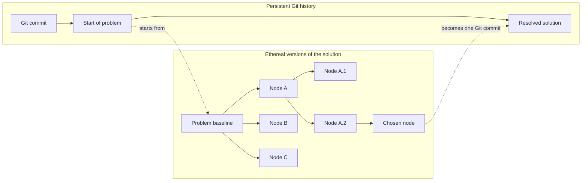

# rim

> Rim is the ethereal version manager that sits between your agent and the next git commit.

## The problem

Agents can write more code than people can afford to evaluate. One task can
produce several plausible implementations, and each implementation can lead to
more variations.

Git gives these attempts two common outcomes:

```text
Delete the branch
    -> keep the repository clean
    -> risk losing useful work

Keep the branch
    -> preserve the work
    -> accumulate branch and cognitive clutter
```

This creates speculative debt. Temporary branches fill the branch list,
experimental commits look like intentional history, and unfinished worktrees
remain after their agents stop. The cost moves from writing code to sorting,
remembering, and cleaning up generated code.

## The mission

Rim makes broad exploration cheap while keeping project history deliberate.
Agents can branch freely inside a temporary solution tree. Only the code that
survives evaluation crosses into the next Git commit.

```text
Git branch:
    assumed valuable until deliberately deleted

Rim node:
    assumed temporary until deliberately kept or removed
```

```text
Git commit:
    assumed fixed until deliberately amended

Rim node:
    assumed editable until a new node is deliberately spawned
```

A Rim tree belongs to one problem. Its nodes are competing solutions or
variations of those solutions. The user can inspect any node, edit it, branch
from it, or remove its complete subtree without adding normal Git branches.

## How Git and Rim stack



Git records durable progress between problems. Rim holds the temporary search
inside one problem. After the user chooses a result, the Rim tree can disappear
without entering public Git history.

## The model

Rim nodes are editable. The active node consists of its consolidated state plus
hot project changes:

```text
consolidated node state
    + hot project changes
    = current visible state
```

`rim punch` consolidates those changes into the same node. It does not create a
normal Git commit or another Rim node.

`rim spawn` creates child nodes from the active node. Two or more children form
sub-branches of the same solution search. A child keeps the exact parent state
from which it spawned. Hot changes can be punched into the active node or
captured in a newly spawned child, leaving the parent unchanged.

Rim does not require a separately named session. Each node has an identifier
that is unique within the repository. In a Git repository, each Git commit can
anchor its own Rim tree. The first `rim spawn` at a commit implicitly creates a
base node from that commit before creating the child. The current Git commit
determines the applicable Rim root and its active node. If the commit changes,
Rim uses the root for the new commit or creates one on the next spawn. Outside
Git, the first spawn creates the base node from the current project state.
`rim init` can create the same base node explicitly without spawning a child.
In standalone mode, `rim init --new` starts another root from the current state.

Rim copies each base state into its own `.rim/` storage. A Git commit ID records
where a root came from, but the root does not depend on that Git object
remaining available. Rim implements its Git-style object storage directly and
does not use Git to manage Rim objects. Git does not store Rim state, and Rim
does not use Git status as its own status.

## Proposed command set

```bash
# Create a base node explicitly; --new starts another standalone root
rim init [--new]

# Create child nodes from the active node
rim spawn [--tag <name>] [--fan-out <n>]

# Consolidate hot changes into the active node
rim punch [-m <message>]

# Switch to another node
rim switch <node-id>

# Delete one inactive node and all descendants
rim purge <node-id>

# Keep only the active node in the current root
rim prune

# Keep only the active node across the complete repository
rim prune --all
```

Read operations expose the tree without changing it:

```bash
rim tree [--json]
rim status [<node-id>] [--json]
rim diff <node-id> [<other-node-id>] [path...] [--json]
```

## Scope

Rim manages temporary versions in the current project directory. It does not
prompt agents, run LLM loops, evaluate solution quality, or decide which node
wins. Rim has no staging layer: `punch` and `spawn` save changes in Rim, while
Git staging and commits remain independent. A state can therefore be saved in
Rim, Git, both, or neither.

Rim also works without an enclosing Git repository by storing its own temporary
node snapshots. This mode provides solution-tree management, not a replacement
for long-term source control.

## Install

Rim requires a current stable Rust toolchain and, for Git-backed projects, the
`git` executable on `PATH`.

```bash
cargo build --release
# Copy target/release/rim (rim.exe on Windows) to a directory on PATH.
```

Standalone mode does not require Git. Rim creates private storage in `.rim/`
and excludes it from both Rim snapshots and normal Git tracking.

## Quick start

```bash
# Explicitly capture the baseline (the first spawn can also do this).
rim init

# Edit files, then capture those edits in a new active candidate.
rim spawn --tag first-approach

# Continue editing the same candidate and consolidate it in place.
rim punch -m "working implementation"

# Create three alternatives without leaving the current node.
rim spawn --tag variant --fan-out 3
rim tree

# Inspect and switch using the stable node IDs printed by tree.
rim status
rim diff <node-id>
rim switch <node-id>

# Remove rejected work. Confirmation can be supplied noninteractively.
rim purge <rejected-node-id> --yes
rim prune --yes
```

Add `--json` to any command for a versioned JSON envelope. Confirmation-required
commands never prompt in JSON mode and require `--yes`.

## Implementation notes

The MVP stores versioned canonical objects as Zstandard-compressed loose
objects addressed by the BLAKE3 hash of their uncompressed canonical content.
Directory objects are sorted complete logical trees, so unchanged files and
subdirectories are shared between snapshots. SQLite stores only mutable root,
node, active-pointer, and recovery metadata. Switches use a repository lock,
collision checks, a recorded transaction, and per-path backups before replacing
managed files.

The product model is documented in [`PRODUCT.md`](PRODUCT.md), and technical
constraints are documented in [`SPECS.md`](SPECS.md).

## License

Rim is available under the [MIT License](LICENSE).
