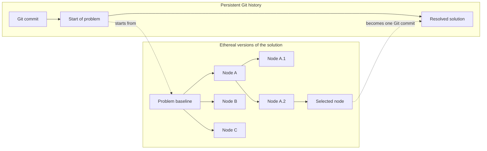

# rim

> Rim is the ethereal version manager that sits between your agent and the next git commit.

## The problem

Agents can write more code than people can afford to evaluate. One task can
produce several plausible implementations, and each implementation can lead to
more variations.

Git gives these attempts two common outcomes:

```text
Delete the branch
    -> keep the repository clean
    -> risk losing useful work

Keep the branch
    -> preserve the work
    -> accumulate branch and cognitive clutter
```

This creates speculative debt. Temporary branches fill the branch list,
experimental commits look like intentional history, and unfinished worktrees
remain after their agents stop. The cost moves from writing code to sorting,
remembering, and cleaning up generated code.

## The mission

Rim makes broad exploration cheap while keeping project history deliberate.
Agents can branch freely inside a temporary solution tree. Only the code that
survives evaluation crosses into the next Git commit.

```text
Git branch:
    assumed valuable until deliberately deleted

Rim node:
    assumed temporary until selected or purged
```

A Rim tree belongs to one problem. Its nodes are competing solutions or
variations of those solutions. The user can inspect any node, edit it, branch
from it, or remove its complete subtree without adding normal Git branches.

## How Git and Rim stack



Git records durable progress between problems. Rim holds the temporary search
inside one problem. After the user selects a result, the Rim tree can disappear
without entering public Git history.

## The model

Rim nodes are editable. The active node consists of its consolidated state plus
hot workspace changes:

```text
consolidated node state
    + hot workspace changes
    = current visible state
```

`rim punch` consolidates those changes into the same node. It does not create a
normal Git commit or another Rim node.

`rim spawn` creates child nodes from the active node. Two or more children form
sub-branches of the same solution search. A child keeps the exact parent state
from which it spawned.

## Proposed command set

```bash
# Create child nodes from the active node
rim spawn [--tag <name>] [--fan-out <n>]

# Consolidate hot changes into the active node
rim punch [-m <message>]

# Make another node active
rim switch <node-id>

# Delete one node and all descendants
rim purge <node-id>

# Keep the active node and delete all other nodes
rim purge --all
```

Read operations expose the tree without changing it:

```bash
rim tree [--json]
rim status [<node-id>] [--json]
rim diff <node-id> [<other-node-id>] [path...] [--json]
```

## Scope

Rim manages temporary versions and the workspaces that use them. It does not
prompt agents, run LLM loops, evaluate solution quality, or decide which node
wins. In a Git project, normal Git commands still create the durable commit.

Rim also works without an enclosing Git repository by storing its own temporary
node snapshots. This mode provides solution-tree management, not a replacement
for long-term source control.

## Project status

Rim is currently in the design stage. The product model is documented in
[`PRODUCT.md`](PRODUCT.md).
